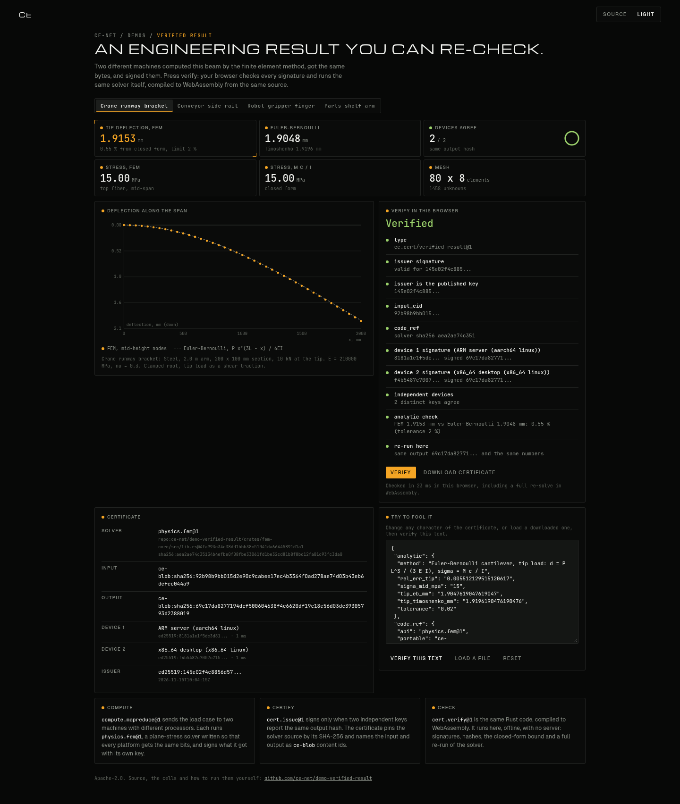

# demo-verified-result

An engineering result you can re-check. Two machines with different processors compute a cantilever
beam by the finite element method, get the same output bytes and sign them. A certificate binds the
solver source, the input and the output. Any browser can then check every signature and re-run the
solver itself, compiled to WebAssembly from the same Rust file, and get the same hash.

Live page: https://ce-net.com/demos/verified



## What was shown (2026-11-15)

| Load case | Mesh | FEM tip deflection | Euler-Bernoulli | Difference | Output hash, x86_64 = aarch64 = wasm32 |
|---|---|---|---|---|---|
| see [docs/RESULTS.md](docs/RESULTS.md) | | | | | |

- Two independent devices, an ARM server (aarch64 Linux) and an x86_64 desktop (x86_64 Linux), produced
  the same output content id for every case. The same id comes out of the wasm build in the browser.
- The FEM tip deflection is within 2 % of the closed form P L^3 / (3 E I) for every case (the
  remaining gap is mostly shear deformation, which Euler-Bernoulli leaves out; the Timoshenko value is
  shown next to it).
- Changing any single field of a certificate makes verification fail: `tests/wasm-verify.mjs` edits
  every leaf, one at a time, and every edit is rejected.

## Run it in under 5 minutes

Needs Rust (https://rustup.rs) and Python 3; Node 18+ for the wasm test.

```sh
git clone https://github.com/ce-net/demo-verified-result && cd demo-verified-result
cargo test --workspace                      # solver vs beam theory, pinned output hash, tamper tests
cargo build --release -p cells
export PATH=$PWD/target/release:$PATH

# one case on this machine
echo '{"op":"Solve","input":{"case":"cantilever-q6","e_mpa":210000,"h_mm":200,"l_mm":2000,"nu_milli":300,"nx":80,"ny":8,"p_n":10000,"t_mm":100}}' | physics-fem
```

The `output_cid` is `ce-blob:sha256:69c17da8...2388019` on every machine. Check a certificate from the page:

```sh
cert-verify < web/certs/crane-bracket.json     # exit 0, every check listed
sed 's/"p_n": 10000/"p_n": 10001/' web/certs/crane-bracket.json | cert-verify   # exit 1
```

Run the whole pipeline yourself, on two machines. A pool member is any command that speaks the cell
contract below; `ssh` works, so does a mesh call:

```sh
cp pool/example.json my-pool.json   # edit: this machine + one more that has physics-fem on PATH
POOL=my-pool.json scripts/run-demo.sh
```

With one machine only, list it twice under two names and give the second a different key
(`"cmd": ["env", "PHYSICS_FEM_KEY=/tmp/k2", "physics-fem"]`); the certificate will then honestly
show two keys on one device class.

Open the page locally:

```sh
cargo build --release --target wasm32-unknown-unknown -p verify-wasm
cp target/wasm32-unknown-unknown/release/verify_wasm.wasm web/verify.wasm
python3 -m http.server -d web 8000            # http://localhost:8000
```

## The cells

Every cell reads one JSON line on stdin and writes one JSON line on stdout, the same contract as
[hello-cell-rust](https://github.com/ce-net/ce-net-hello-cell-rust), so each one is reusable on its own.

| Cell | Binary / crate | Does |
|---|---|---|
| `physics.fem@1` | `physics-fem`, [crates/fem-core](crates/fem-core/src/lib.rs) | `Solve{input}` -> result, output blob, and this device's signed claim. 2D plane stress, 4-node elements with incompatible bending modes, banded Cholesky |
| `compute.mapreduce@1` | `compute-mapreduce` | `Run{map, inputs, replicas, pool}`: each input on N distinct pool members at once; a failed member is replaced by the next unused one; reports whether the replicas agree |
| `cert.issue@1` | `cert-issue`, [crates/cert-core](crates/cert-core/src/lib.rs) | Signs only when at least two distinct keys signed the same output hash with the pinned solver. Optionally stores input and output in `ce-blob` (the ce node's `/blobs`) |
| `cert.verify@1` | `cert-verify`, and [crates/verify-wasm](crates/verify-wasm/src/lib.rs) in the browser | Issuer signature, published issuer key, input hash, solver hash, every device signature, two distinct devices, the closed-form bound, and a full re-run |

## Why the bits match everywhere

`fem-core` is one file with no dependencies. It uses IEEE-754 binary64 with only `+ - * /` and
`sqrt`, which the standard requires to be correctly rounded, in one fixed loop order: no fused
multiply-add (Rust never contracts on its own), no threads, no hash maps, no `sin`/`exp`/`pow` from a
platform maths library. Input is integers only, so it has one canonical encoding. The output blob is
the raw little-endian doubles.

## The certificate

```text
type        ce.cert/verified-result@1
code_ref    physics.fem@1, repo:ce-net/demo-verified-result/crates/fem-core/src/lib.rs@<commit> sha256:<file hash>
            (also as a portable ce-ref://repo/<origin id>/crates/fem-core/src/lib.rs)
input       the canonical case;            input_cid  ce-blob:sha256:<sha256 of it>
result      tip and stress (decimal and IEEE bits), deflection line;  output_cid  ce-blob:sha256:<sha256 of the blob>
analytic    Euler-Bernoulli and Timoshenko values, relative error, tolerance 0.02
nodes[]     per device: class, ed25519 key, solver hash, time, signature over
            "ce.cert/node-claim@1\n" + {api, code_sha256, device_class, input_cid, output_cid, pub}
issuer, sig the issuer's ed25519 signature over "ce.cert/verified-result@1\n" + every other field
```

Canonical JSON is keys sorted, no whitespace. `web/keys.json` publishes the issuer key the page trusts.

## Limits

- One element type and one load case kind (cantilever, tip load). A heat-sink case would be a second
  `case` kind in the same cell.
- The page shows certificates computed ahead of time by the two devices; a viewer re-checks them but
  does not start a new two-device run from the browser.
- Agreement of two devices shows the computation is reproducible, not that the model is right; the
  closed-form check is there for that.

## License

Apache-2.0, see [LICENSE](LICENSE). Author: Leif Rydenfalk.
